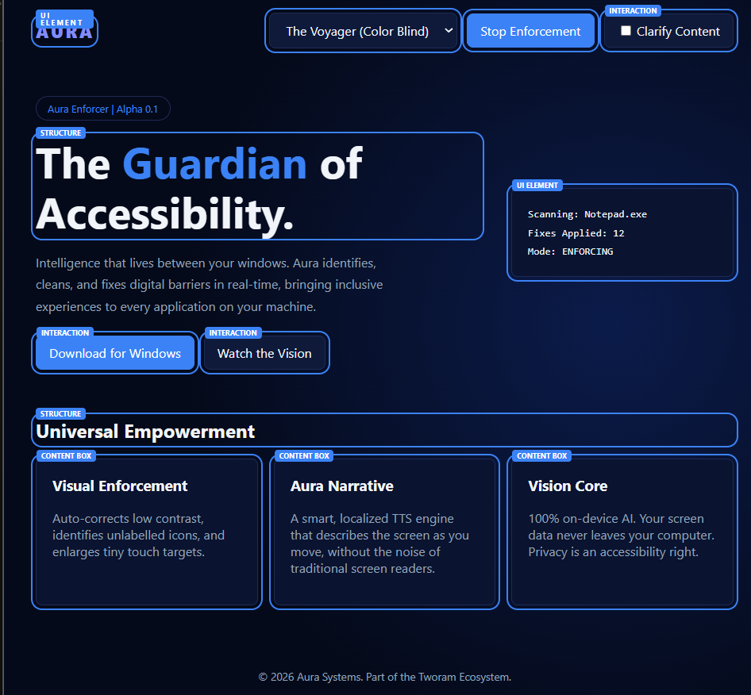
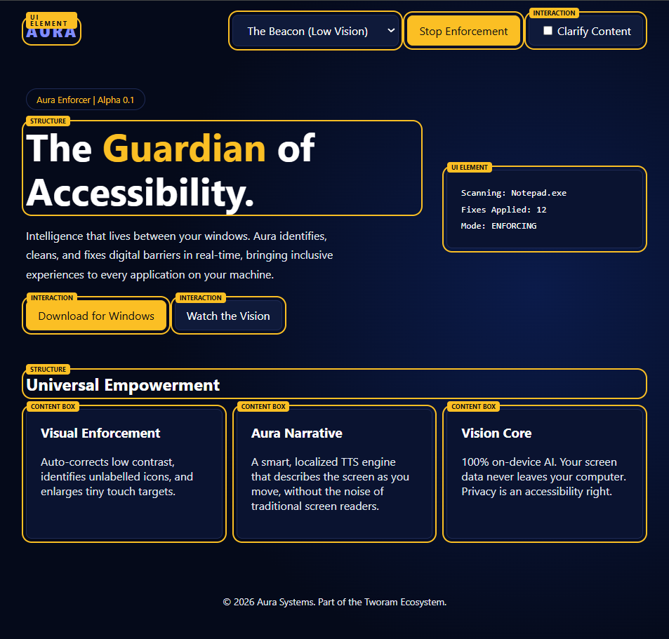
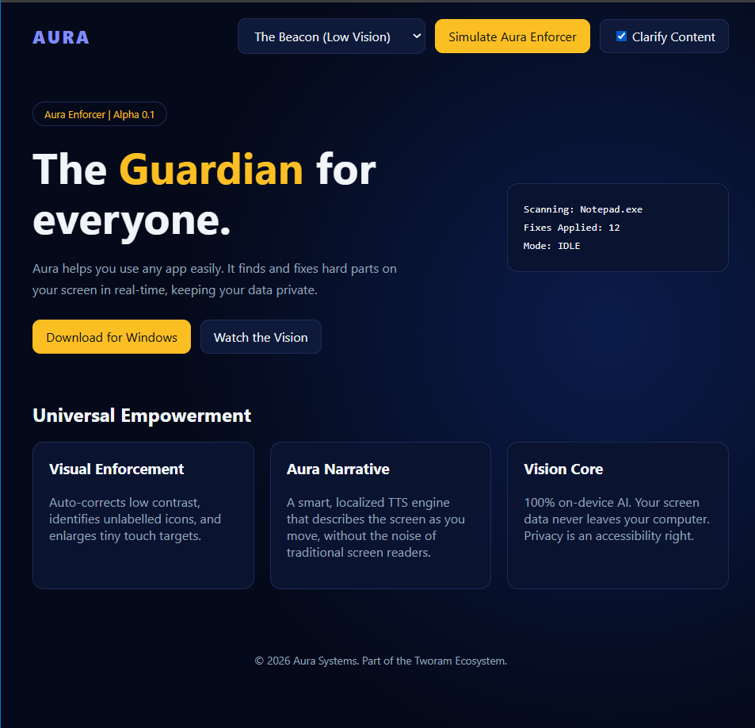
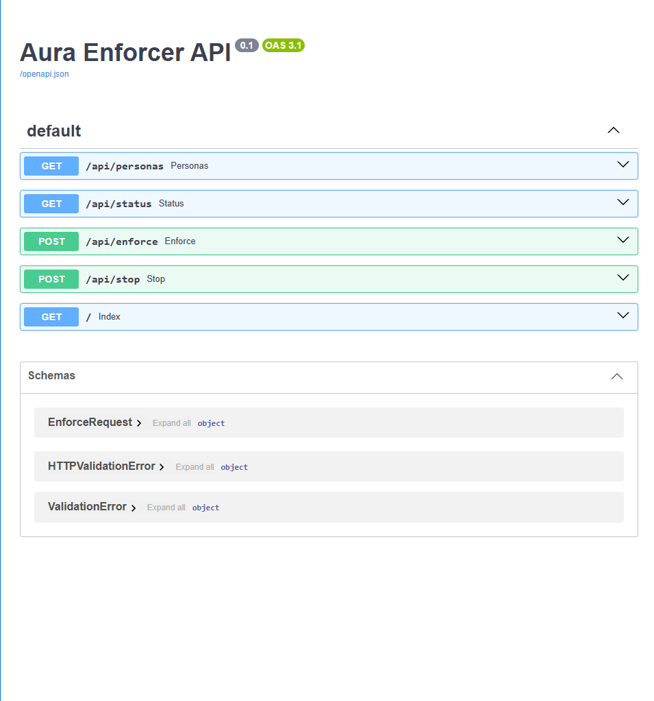

# Aura Enforcer: Reverse Engineer a Result (APL-project 2026)

**Author:** Fady Soweha
**Track chosen:** API (FastAPI backend + HTML/CSS/JavaScript front end)

## Project purpose
I was given a screen recording of a finished application called **Aura** (`Aura.mp4`). The task was to work backwards: figure out what code could have produced it, then build a similar application, run it locally, and document the process.

Aura is a landing page for a fictional accessibility tool. It has a persona dropdown, a *Simulate / Stop Enforcement* button, a *Clarify Content* toggle and a status card.

## Screenshots
| Enforcing, The Voyager | Enforcing, The Beacon |
|---|---|
|  |  |

| Clarify Content on, enforcement stopped | API documentation (/docs) |
|---|---|
|  |  |

## Phase 1: Research (pre-study)
**What I did**
- Watched the recording and noted everything that happens when I click each control.
- Read the address bar in the video: `.../aura/static/index.html`. A `static` folder suggests a small backend that serves static files.
- Used GenAI (Claude) to help analyse frames of the video and to ask questions: what kind of page is this, what could create the labels and outlines, what data does the status card show?
- Chose the tools: **Python + FastAPI** for the backend (automatic API docs, little code) and plain **HTML/CSS/JavaScript** for the front end.

**Reverse engineering (steps from the brief)**
- *Inputs:* selected persona, click on Simulate/Stop, Clarify Content toggle.
- *Process:* JavaScript marks elements with `data-aura`, adds an outline and a small label to each, a body class switches the colour theme, and the text is swapped between a normal and a simple version.
- *Fake functions I sketched:* `startEnforcement()`, `stopEnforcement()`, `setPersona()`, `toggleClarify()`.

**Problems and solutions**
- *Problem:* I could not see the code, only the result. *Solution:* I treated the page like a detective case: listed every visible behaviour and guessed the simplest logic that explains it.

## Phase 2: Implementation
**Project structure**
```
aura/
├── main.py            # FastAPI backend
├── requirements.txt   # fastapi, uvicorn
├── README.md
├── screenshots/
└── static/
    └── index.html     # page, CSS and JavaScript
```
**Order of work**
1. Backend with an in-memory state: `scanning`, `fixes`, `mode`, `persona`.
2. Endpoints: `GET /api/status`, `GET /api/personas`, `POST /api/enforce`, `POST /api/stop`, and `GET /` for the page.
3. Static page with the layout, dark theme and the three cards.
4. JavaScript: tagging elements, theme switching, Clarify Content and the calls to the API.

**Problems and solutions**
- *Problem:* `uvicorn: command not found` and `No module named uvicorn`. *Solution:* the installed packages were wrong. `pip install -r requirements.txt` installed Flask, which meant `requirements.txt` was an old file with the same name from my Downloads folder. I rewrote it with `fastapi` and `uvicorn` and installed again.
- *Problem:* the page had no `data-aura` attributes. *Solution:* `index.html` was also an old file. I checked it with `grep -c "data-aura"` (it returned 0), then replaced it.
- *Problem:* pip and venv were missing in WSL. *Solution:* `sudo apt install python3-venv python3-pip`, then a fresh virtual environment.

## Phase 3: Completion
**Testing**
- Simulate adds outlines and labels, and the button changes to *Stop Enforcement*.
- Persona switch changes the theme from blue to yellow.
- Clarify Content swaps the headline and the paragraph.
- Stop removes all overlays and sets the mode back to `IDLE`.
- `/docs` lists every endpoint and lets me try them.

**Improvements**
- *Problem:* the "UI ELEMENT" label wrapped onto two lines and covered the logo. *Solution:* added `white-space: nowrap` to the label style.
- *Problem:* the status card showed 16 tagged elements in my first estimate. *Solution:* the page really has 12 tagged elements, which also matches the original video, so I trust the count from the app itself.

## Phase 4: Summary of problems and solutions
| Problem | Solution |
|---|---|
| Could not see the original code | Worked backwards from behaviour: inputs, process, sketch |
| Wrong `requirements.txt` (Flask) | Rewrote it with `fastapi` and `uvicorn` |
| Old `index.html` in the project | Checked with `grep`, replaced the file |
| pip/venv missing in WSL | Installed `python3-venv` and `python3-pip` |
| Label covering the logo | `white-space: nowrap` on the label |
| Commands failed when I copied the prompt text | Copy only the command, not `(venv) user@host:~$` |

## How to run
```bash
python3 -m venv venv
source venv/bin/activate
pip install -r requirements.txt
python -m uvicorn main:app --reload
```
Open http://localhost:8000 (API docs at http://localhost:8000/docs).

## API
| Method | Path | Description |
|---|---|---|
| GET | /api/status | current state |
| GET | /api/personas | available personas |
| POST | /api/enforce | start enforcement `{persona, fixes}` |
| POST | /api/stop | stop enforcement |

## Conclusion
**What I achieved:** a working local application that behaves like the original Aura recording: persona themes, enforcement overlay with labels, Clarify Content and a live status card from a FastAPI backend.

**What I learned:** how to reverse engineer an application from its behaviour, how a front end and an API communicate, how to use GenAI as a helper while checking its output myself, and how to debug a real setup (virtual environments, wrong files, missing packages).

**What could be improved:** the fonts and glow effects are simpler than the original; the tagging is simulated rather than scanning a real application; the state is only in memory, so it resets when the server restarts; and the layout could be tested on more screen sizes.
